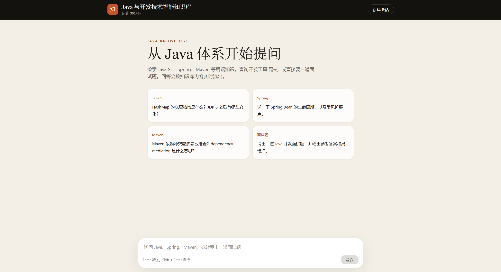
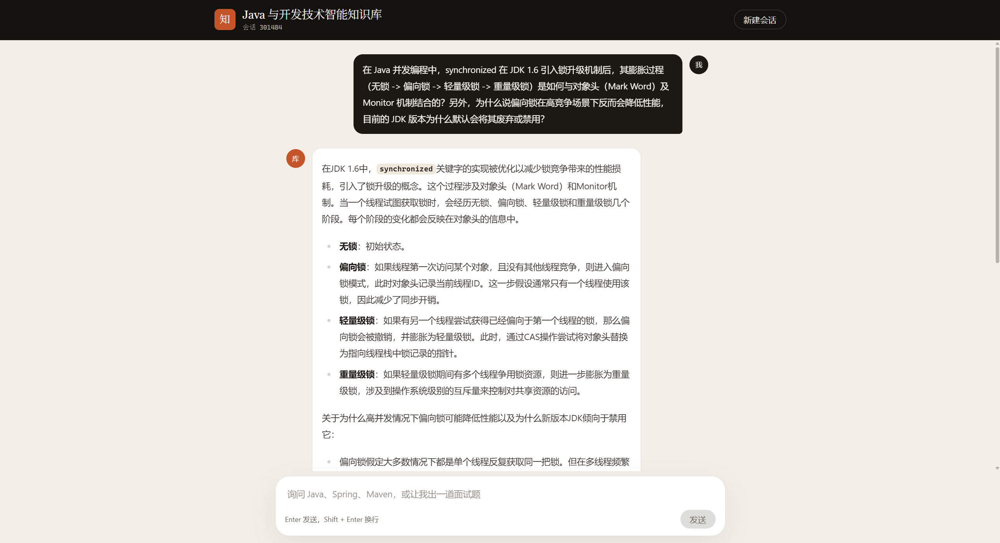
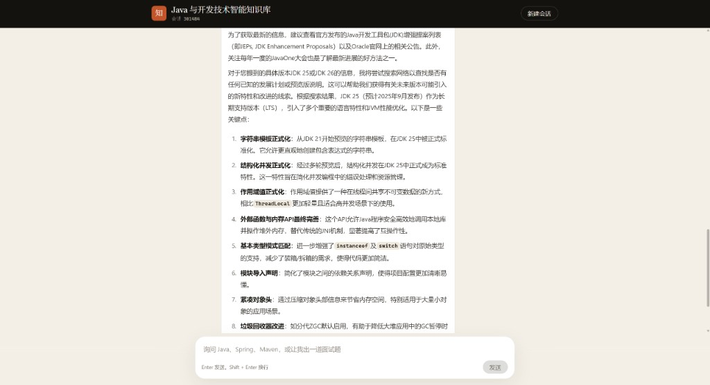

# Java and Development Technology Knowledge Base

> Java backend Q&A and interview coaching, built with LangChain4j and Qwen

[](https://spring.io/projects/spring-boot)
[](https://react.dev/)
[](https://github.com/langchain4j/langchain4j)
[](https://www.oracle.com/java/)

A conversational knowledge base for beginners in Java backend development. Answers stream over SSE, typewriter-style, and render code and lists as Markdown. Questions covered by the knowledge base are answered directly. Programming questions outside it trigger a Runoob search, then an answer assembled from the titles, links, and snippets.

## About

### What it does

- Programming help: explain Java, Spring, and Maven questions in Simplified Chinese, with short examples
- Knowledge retrieval: answer from the local Markdown knowledge base, and stay closer to those sources
- Interview coaching: ask for an interview question on a topic such as concurrency, with a sample answer and common pitfalls

The source documents live in `backend/src/main/resources/docs` and currently cover:

- Java SE and Java EE
- Spring and Maven
- JDBC, MyBatis, and Redis
- JVM, JUnit, and concurrency

### Technology

#### AI service

- **LangChain4j**: chat service, conversation memory, RAG, tool calling, and guardrails are assembled here
- **Qwen**: chat model `qwen-max`, embedding model `text-embedding-v4`
- **Streaming**: `GET /api/ai/chat` returns `text/event-stream`, and the frontend appends each chunk

#### Safety

- **Input guardrail**: checks the user message before it is sent, and refuses to call the model when a sensitive term matches

#### Integrations

- **RAG**: on startup, documents are split and stored in an in-memory vector store; retrieval returns at most 5 segments with a score of at least 0.75
- **Conversation memory**: each `memoryId` keeps its own last 10 messages; starting a new chat uses a new memory
- **MCP web search**: supplements answers with live results through Zhipu MCP Web Search
- **Runoob search**: for programming topics the knowledge base does not cover, Jsoup fetches Runoob search results

## Screenshots

The home page offers four suggestions: Java SE, Spring, Maven, and interview questions. Click a card to ask.

[](./demo/01-home.png)

A concurrency question is answered from the knowledge base as a stream, including the stages of lock escalation.

[](./demo/02-synchronized.png)

Questions about language versions are organized into points, with code and terms shown as Markdown.

[](./demo/03-jdk25.png)

## Quick start

### Requirements

- **Java**: JDK 21+
- **Node.js**: 18+
- **Maven**: 3.6+
- **Qwen API**: one key each for chat, streaming chat, and embeddings
- **Zhipu API**: one key for MCP web search

### Run it

#### 1. Configure keys

`backend/src/main/resources/application.yml` already activates the `local` profile. Create `application-local.yml` in the same directory (it is gitignored) and add your own keys:

```yaml
langchain4j:
  community:
    dashscope:
      chat-model:
        api-key: your DashScope API key
      embedding-model:
        api-key: your DashScope API key
      streaming-chat-model:
        api-key: your DashScope API key
bigmodel:
  api-key: your Zhipu API key
```

`RagConfig` currently loads the whole `backend` directory from an absolute path on this machine. After moving the project, change the argument of `FileSystemDocumentLoader.loadDocuments(...)` to your own `backend` directory.

#### 2. Start the backend

```bash
cd backend
mvn spring-boot:run
```

The server listens on `http://localhost:8081` with context path `/api`.

#### 3. Start the frontend

```bash
cd web
npm install
npm run dev
```

#### 4. Open the app

- Frontend: <http://localhost:5173>
- Backend API: <http://localhost:8081/api>

The dev server proxies `/api` to `http://localhost:8081`. In the page, `Enter` sends and `Shift + Enter` inserts a new line.

## Architecture

```text
┌──────────────────────┐    ┌──────────────────────┐
│   React frontend     │────│    Spring Boot       │
│   - Chat UI          │    │    backend           │
│   - Live streaming   │    │   - REST API         │
│   - Markdown         │    │   - SSE stream       │
└──────────────────────┘    └──────────────────────┘
                                      │
                            ┌──────────────────────┐
                            │    LangChain4j       │
                            │   - AI service       │
                            │   - Tool integration │
                            │   - Safety checks    │
                            └──────────────────────┘
                                      │
                            ┌──────────────────────┐
                            │   Qwen API           │
                            │   - Chat model       │
                            │   - Embedding model  │
                            │   - Streaming output │
                            └──────────────────────┘
```

## Core modules

- `AiService`: service interface for chat, structured output, RAG answers, and streaming sessions
- `JavaTechCopilotServicFactory`: wires the streaming model, conversation memory, retriever, local tools, and MCP
- `QwenChatModelConfig`: Qwen chat model configuration
- `RagConfig`: document loading, splitting, embedding, and content retrieval
- `McpConfig`: MCP client for Zhipu Web Search
- `InterviewQuestionTool`: Runoob search
- `SafeInputGuardrail`: input safety checks
- `ChatModelListenerConfig`: logs model requests, responses, and errors

## Layout

```text
java-tech-copilot/
├── README.md
├── pom.xml                 # aggregates backend
├── demo/                   # screenshots
├── backend/                # Spring Boot, port 8081
│   └── src/main/resources/docs
└── web/                    # React + Vite, port 5173
```

## Acknowledgements

- [LangChain4j](https://github.com/langchain4j/langchain4j) - Java framework for AI applications
- [Alibaba Cloud Qwen](https://dashscope.aliyun.com/) - chat and embedding models
- [Spring Boot](https://spring.io/projects/spring-boot) - application framework
- [React](https://react.dev/) - user interface
